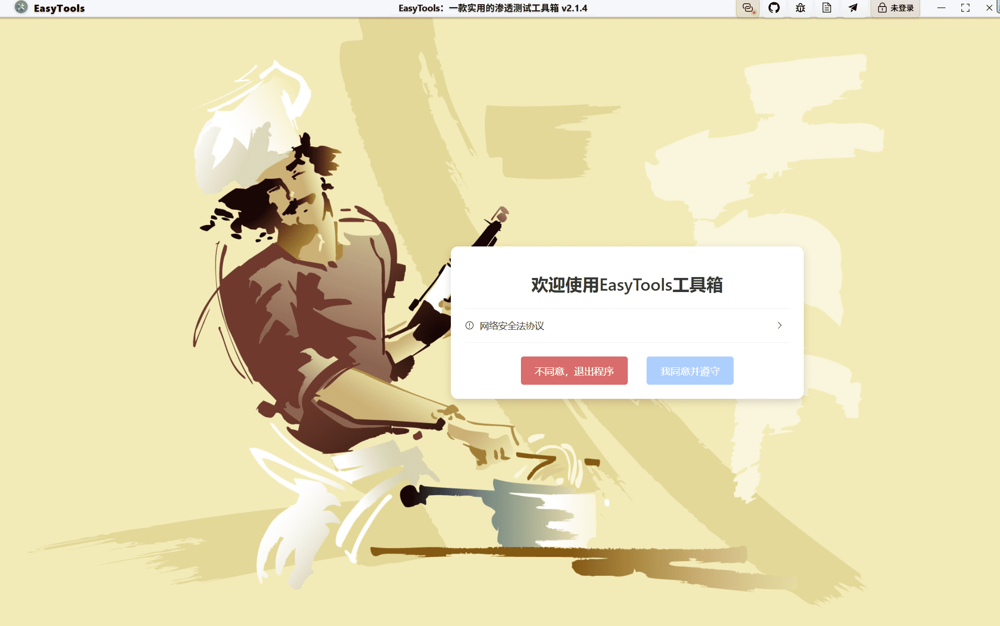
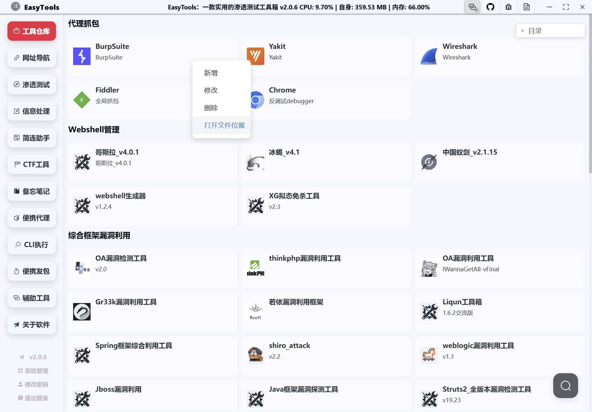
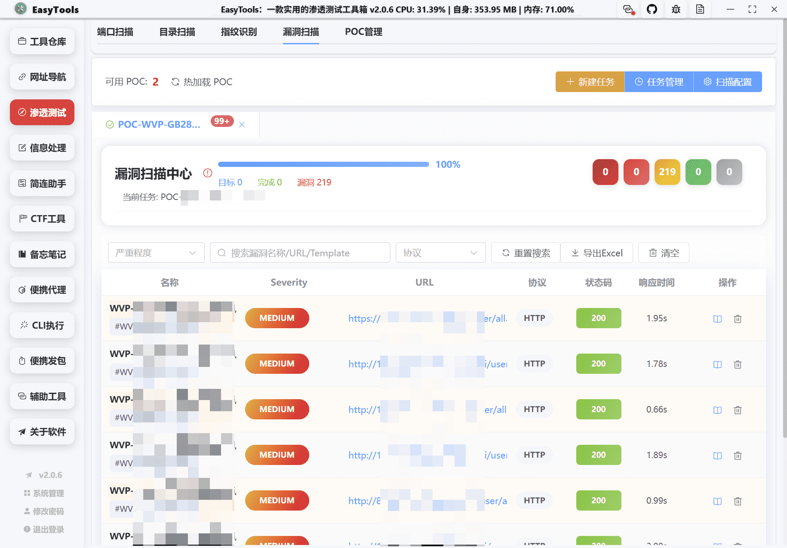
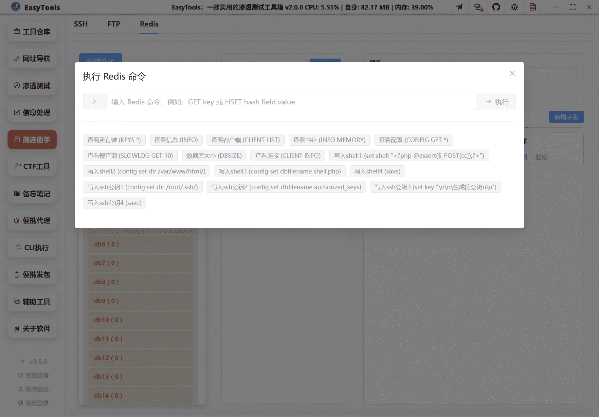
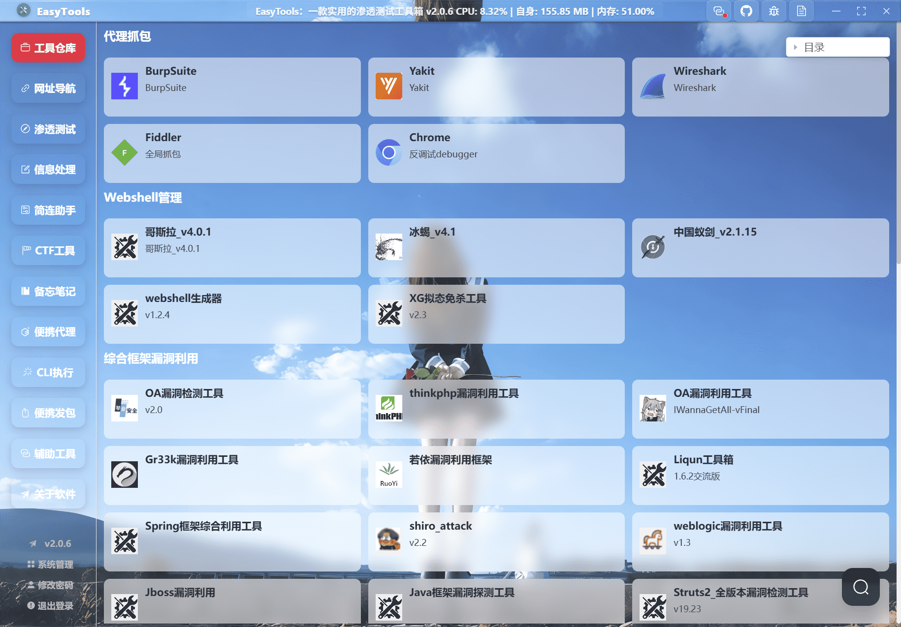

# EasyTools · 渗透测试工具箱（v2.3.1开源版-全开源包含免杀模块）

一款面向安全从业者的综合性桌面工具箱（Go + Wails + Vue 3），把日常安服、渗透测试、护网期间
高频使用的模块集中到一个客户端里，减少在十几个工具之间来回切换的成本。

本仓库为 EasyTools 的全量开源版本，全部功能模块与源码完整开放。




## 功能一览

| 分类 | 模块 |
|---|---|
| 资产管理 | 工具仓库、网址导航、空间测绘（FOFA / Hunter / Quake / 零零信安）、子域名收集、ICP 备案、小程序信息提取 |
| 渗透测试 | 指纹识别、目录扫描、端口扫描、漏洞扫描（nuclei POC 管理）、JSFinder 接口提取、主机存活扫描、密码爆破、Druid 利用 |
| 信息处理 | 编码解码、加密解密、JWT 分析与爆破、IP 归属地、pcap 流量包分析、Google 语法生成、社工字典生成 |
| 连接管理 | 简练助手（SSH / SFTP / FTP / MySQL / MariaDB / PostgreSQL / SQLServer / Oracle / SQLite / Redis / MongoDB 等） |
| 云上安全 | 阿里云 / 腾讯云 / 华为云 / 百度云 / UCloud AK·SK 连接与资源清点、对象存储与 OSS 桶管理 |
| 载荷处理 | Shellcode 处理、Loader 生成、白加黑（SkyShadow）挖掘、数字签名、图标替换、UPX 特征处理 |
| 效率工具 | 便携发包（RestMate）、备忘笔记、CLI 执行与定时任务、MCP Server、辅助工具、CTF 工具 |

## 界面预览

| 工具仓库 | 渗透测试 |
|---|---|
|  |  |

| 简练助手 | 云上安全 |
|---|---|
|  |  |

## 环境要求

- **Go** 1.24 及以上
- **Node.js** 18 及以上（推荐 20/22 LTS）
- **Wails CLI** v2.10.2：`go install github.com/wailsapp/wails/v2/cmd/wails@v2.10.2`
- **MinGW-w64**（仅 Windows 生成免杀载荷需要 cgo 交叉编译）
- **UPX**（可选，用于产物压缩）

平台依赖：

- Windows：WebView2 Runtime（Win10/11 通常已内置）
- macOS：`xcode-select --install`
- Linux：`libgtk-3-dev libwebkit2gtk-4.0-dev libayatana-appindicator3-dev librsvg2-dev build-essential`

## 构建

```bash
# 1. 克隆
git clone https://github.com/doki-byte/EasyTools.git
cd EasyTools

# 2. 安装前端依赖
cd frontend && npm install && cd ..

# 3. 开发模式（热更新）
wails dev

# 4. 发布构建
wails build --trimpath -ldflags="-w -s"
```

Windows 也可直接双击 `build.bat`（默认 `windows/amd64`，支持 `build.bat windows/386`）；
macOS / Linux 使用 `./build.sh mac arm64`、`./build.sh linux amd64`。

> Wails 依赖各平台原生 WebView，macOS / Linux 产物必须在对应系统上构建，或在推 `v*` 标签后由
> `.github/workflows/build.yml` 自动产出四平台安装包。

## 目录结构

```
.
├── main.go                 # 入口：GUI 模式 / MCP stdio 模式
├── app/
│   ├── bypass/             # 载荷处理：Loader 生成、白加黑、签名、图标、PE 处理
│   ├── controller/         # 各功能模块的控制器（Gin 路由 + Wails 绑定）
│   │   ├── connect/        # SSH / FTP / 数据库 / Redis 等连接管理
│   │   ├── cloudSecurity/  # 云平台 AK·SK、对象存储
│   │   ├── cyberSabre/     # 渗透测试模块
│   │   └── ...
│   ├── embed/              # 内置资源：字典、指纹库、CyberChef、小程序反编译运行时
│   ├── lib/nuclei/         # 内置的 nuclei 引擎（上游 MIT 项目，本地 replace）
│   ├── model/              # 数据模型（GORM）
│   └── util/
├── frontend/               # Vue 3 + Element Plus 前端
│   ├── src/
│   └── wailsjs/            # Wails 自动生成的绑定
├── build/                  # 应用图标与打包资源
└── .github/workflows/      # 四平台 CI 打包
```

运行期数据目录 `EasyToolsFiles/` 在首次启动时自动生成（配置库、日志、字典、生成的载荷等），
该目录不纳入版本控制。

## 二次开发

- 新增 HTTP 接口：在 `app/controller/<模块>` 中注册 Gin 路由，参考现有模块的 `start()` 结构。
- 新增前端页面：在 `frontend/src/views` 添加组件，并在 `frontend/src/router/index.js` 与
  `frontend/src/utils/menuConfig.js` 中登记。

贡献流程见 [CONTRIBUTING.md](CONTRIBUTING.md)。

## 许可证

本项目以 **MIT License** 发布，见 [LICENSE](LICENSE)。

项目内包含或引用的第三方组件（nuclei、CyberChef、Wails、Element Plus 等）遵循其各自许可证，
完整清单见 [NOTICE.md](NOTICE.md)。

## 免责声明

1. 本工具仅面向**合法授权**的安全测试、漏洞评估与安全研究场景使用。
2. 使用本工具进行任何测试前，请确认你已获得目标系统的明确授权，并遵守所在国家/地区的法律法规。
3. 因使用本工具产生的一切后果由使用者自行承担，作者与贡献者不承担任何直接或间接责任。
4. 请勿将本工具用于任何未授权的入侵、数据窃取或破坏行为。

## Star History

[](https://starchart.cc/doki-byte/EasyTools)
